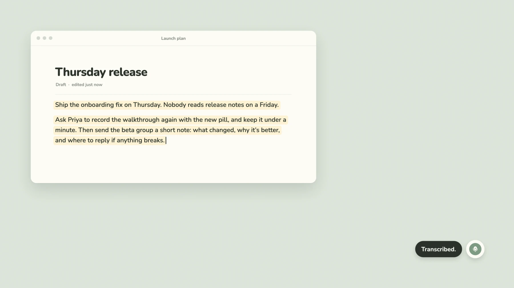
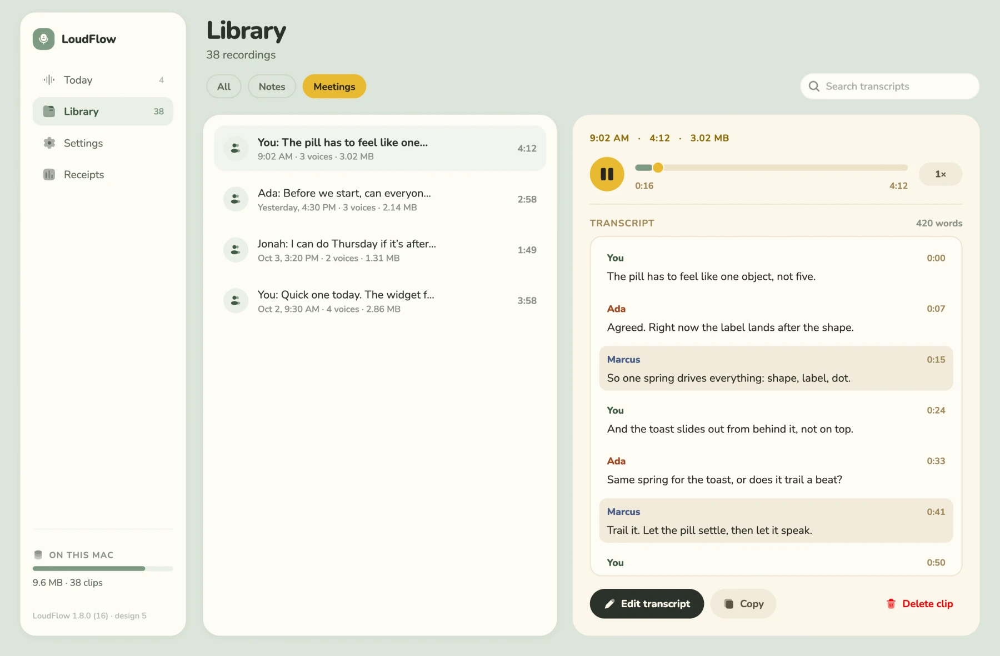

# LoudFlow

A personal macOS dictation app I made for myself. A small always-on-top widget floats over whatever app
you're using. Click it (or hold a key / double-tap Control), talk, and when you stop it
types the **raw transcript** straight into the field your cursor is in. Audio and transcript
are kept locally so you can open the app and fix the transcript manually.





## What you can do with it

- Dictate into any app. The words land where your cursor is.
- Start by clicking the widget, holding ⌥Space, or double-tapping Control.
- Record a call or a meeting. It hears both sides and labels each speaker.
- Name a voice once and it's suggested the next time that person turns up.
- Play any recording back and fix its transcript.
- Search every transcript.
- Save the names and terms it keeps mishearing, so they come back spelled right.
- Dictate in a mix of languages.
- Keep audio for 7 days, 30 days or forever. Transcripts stay either way.
- See how much typing it saved you.

Recordings stay on your Mac. Transcription runs in the cloud, with your own Deepgram or OpenAI key.

## Install

Download [LoudFlow.dmg](../../releases/latest/download/LoudFlow.dmg), open it, and drag LoudFlow to Applications.

You need an Apple Silicon Mac on macOS 14.2 or later, and a [Deepgram](https://console.deepgram.com) or OpenAI API key.

The first time you open LoudFlow, macOS will block it, because it isn't signed with a paid Apple developer account. Click Done, then go to System Settings › Privacy & Security, scroll down and click Open Anyway. You only do this once.

### Or build it yourself

You need Xcode 15 or later and [XcodeGen](https://github.com/yonaskolb/XcodeGen) (`brew install xcodegen`).

```sh
./scripts/fetch-assets.sh     # downloads Nunito and the Solar icons, once
xcodegen generate             # writes LoudFlow.xcodeproj
open LoudFlow.xcodeproj       # then run with ⌘R
```

No Xcode? Once a copy of LoudFlow is in /Applications, `./scripts/build-without-xcode.sh`
rebuilds and reinstalls it with only the Command Line Tools.

### If you rebuild often

macOS forgets the Accessibility permission each time the app is rebuilt, unless it's signed the
same way every time. `./scripts/dev-signing-setup.sh` makes a self-signed identity once, and
`./scripts/dev-build.sh` builds, signs with it and installs.

## What it asks for

- The microphone, the first time you record.
- Accessibility (System Settings › Privacy & Security › Accessibility), for the shortcuts and for typing into other apps. Without it you can still click the widget and paste from the clipboard.
- System Audio Recording, the first time it records a call, to hear the other side.

The app isn't sandboxed, because the sandbox blocks global shortcuts and typing into other apps.

## Transcription key

LoudFlow uses Deepgram (Nova-3) by default. Setup asks for your API key, and nothing transcribes
without one. You can change it later in Settings › Transcription. The key is stored in the macOS
Keychain. OpenAI (`gpt-transcribe`) is the other choice. It has no speaker labels and a 25 MB
upload limit.

Audio is sent with a zero-retention request, so the provider doesn't keep it.

## The code

- `Sources/LoudFlow/App` is the app's state, the library on disk, the Keychain and voices.
- `Audio` records the microphone and the call, and plays recordings back.
- `Transcription` talks to Deepgram and OpenAI and turns their answers into speaker turns.
- `Input` is the shortcuts, permissions and typing into other apps.
- `Widget` is the floating pill. `Windows` is everything in the main window.
- `DesignSystem` holds the colours, type and components.

The library lives in `~/Library/Application Support/LoudFlow/`: `clips.json` and an `audio` folder.
